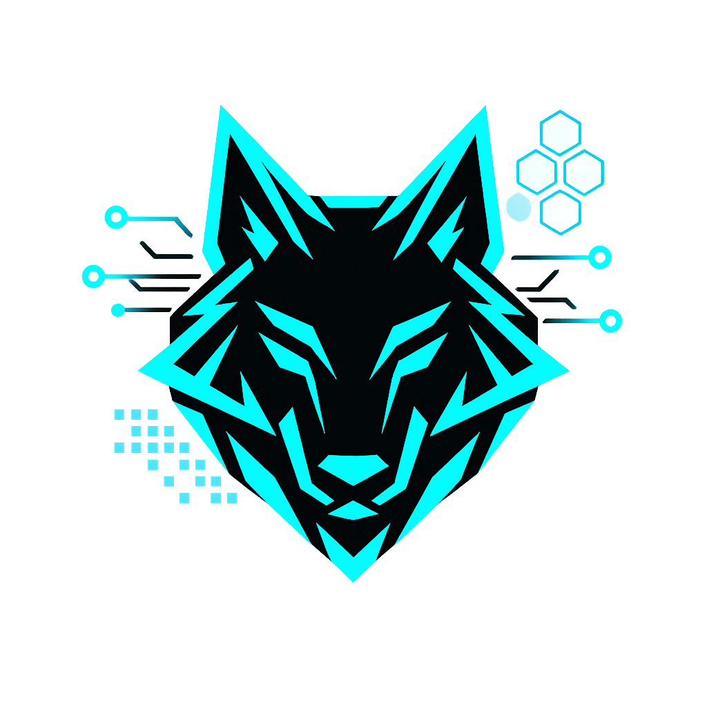
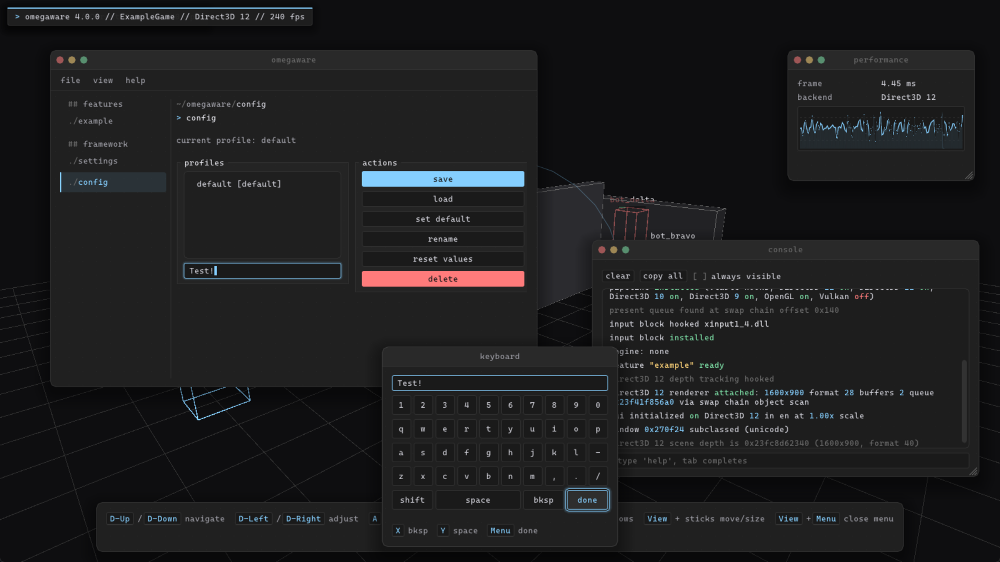

<div align="center">

# OmegaWare Framework



[](https://github.com/Omega172/OmegaWare-Framework/stargazers)
[](LICENSE)
[](https://github.com/Omega172/OmegaWare-Framework/actions)
[](https://github.com/Omega172/OmegaWare-Framework/issues)

</div>

---

OmegaWare is a framework for making Mods/Cheats. It loads into a game, draws its own menu on top of the game's renderer and gives you a feature, config, localization, memory and hooking toolkit to build mods/cheats with.

It is meant for single-player and co-op games that allow modification. It is not built for, and must not be pointed at, competitive or anti-cheat protected games.

## Screenshots

<div align="center">



</div>

---

## Features

- **Overlay on any common renderer**: Direct3D 9, 10, 11 and 12, OpenGL and Vulkan, detected automatically at runtime. DLSS and frame generation on Direct3D 12 are handled. Vulkan support is compiled in when the Vulkan SDK headers are found (`VULKAN_SDK`); a Vulkan game that started before OmegaWare loaded is asked once to recreate its swap chain.
- **Two ways to load**: inject `OmegaWare.dll`, or drop a proxy DLL (`version.dll`, `winmm.dll` or `dinput8.dll`) next to the game executable so it loads without an injector.
- **Menu**: sidebar pages per feature, menu bar, in-game console with commands, watermark, performance window, three themes, automatic UI scaling and full keyboard, mouse and controller navigation.
- **Controller support**: Xbox controllers through XInput, plus DualShock 4 and DualSense over USB or Bluetooth. The whole menu works from the pad, text fields open an on-screen keyboard, and a strip of button hints shows while the menu is open. See [Controllers](#controllers).
- **Input blocking**: while the menu has input, the game stops seeing keyboard, mouse, raw input, XInput, DirectInput (joysticks included, axes left centered) and GameInput. Keys and buttons the game saw pressed are released when the menu takes input, so nothing stays stuck.
- **World drawing**: features can draw into OmegaGUI's world draw list (`OmegaGUI::GetWorldDrawList()`), which the overlay renders before the menu. On Direct3D 9, 11, 12, OpenGL and Vulkan it is depth-tested against the game's own depth, so it hides behind walls; on Direct3D 10 it draws unoccluded. On Direct3D 11, 12 and Vulkan the framework picks the depth buffer the game draws the most into, copies it at the end of the scene (before the game clears or reuses it) and scales it to the screen, so it also works when the game renders at a lower resolution (DLSS, FSR, dynamic resolution). In proxy mode the depth buffers are tracked from the moment the game creates its device; when injected later, Direct3D 12 still finds the depth buffer through the game's resource barriers (most engines, Unreal included), while Vulkan only sees depth images the game creates after injection (for example after a resolution change). The example feature's depth probe (a full-screen quad at a chosen depth, red where the game's geometry is in front) shows whether depth is available in a game.
- **Feature system**: features register themselves and get guarded `Setup`, `Run`, `Render`, `DrawMenu` and `Destroy` calls. A crash inside one feature disables only that feature.
- **Config profiles**: values, colors and keybinds (always on, hold or toggle) saved as JSON profiles with a default profile loaded at startup.
- **Localization**: English, German and Polish built in, with runtime switching and overrides loaded from disk.
- **Memory tools**: compile-time signature patterns, scanning that only touches readable memory, relative address resolving, safe reads and `CreateInterface` lookups on x64 and x86.
- **Typed hooks**: `clHook<Fn>` and transactional `clHookBatch`, removed safely even while the hooked function is being called.
- **Engine interfaces**: Unreal Engine through a Dumper-7 SDK, Unity Mono and Unity IL2CPP.
- **Logging**: per-launch log and error log files in `Documents\OmegaWare\<game>\Logs`, with source locations on warnings and errors, an optional Windows console window and the in-game console.
- **Crash dumps**: a fault inside a feature or the overlay writes a minidump to `Documents\OmegaWare\<game>\Crashes` (up to five per session).
- **Version and target game**: set once in xmake, shown in the log, watermark and about dialog and embedded in the DLL's version info.

---

## Repository layout

The framework links three libraries, included as git submodules under `Source/Third-Party/OmegaWareProjects/`:

```
Source/Third-Party/OmegaWareProjects/
  OmegaWare-GUI/            immediate-mode GUI library (OmegaGUI)
  OmegaWare-RenderHook/     renderer and input hooks (OmegaRenderHook)
  OmegaWare-Localization/   localization library (OmegaLocalization)
```

If a submodule is not checked out, xmake uses a folder of the same name next to this repository instead. Other locations can be passed with `--gui=`, `--renderhook=` and `--localization=` when configuring.

```
Source/
  OmegaWare/          the framework: DllMain, Core, Config, Features, Hooks, Memory, Menu, Overlay, Engines, Locales
  OmegaWareProxy/     proxy DLL exports and the export generator
  OmegaWarePlugin/    the header plugins include (plugin API)
  ExamplePlugin/      an example hot-reloadable plugin
  OmegaWareTests/     test runner for memory, hooks, input blocking, engines and proxies
```

---

## Building

Requirements:

- [Xmake](https://xmake.io/guide/quick-start.html#installation)
- Visual Studio 2022 or newer with the C++ workload
- [vcpkg](https://github.com/microsoft/vcpkg) for `nlohmann-json`

```bash
git clone --recursive https://github.com/Omega172/OmegaWare-Framework.git
cd OmegaWare-Framework
```

In an existing clone, fetch the libraries with:

```bash
git submodule update --init --recursive
```

Build with the helper scripts (mode defaults to release, arch to x64):

```bash
Build.bat debug x64
```

Or with xmake directly:

```bash
xmake config -p windows -m debug -a x64
xmake build
```

Outputs go to `Build/<Debug|Release>/<x64|x86>/`:

| Target | Output |
|--------|--------|
| `OmegaWare` | `OmegaWare/OmegaWare.dll` for injection |
| `OmegaWareProxy` | `OmegaWareProxy/<proxy>.dll` for proxy loading |
| `Proxies` group | `OmegaWareProxies/version.dll`, `winmm.dll` and `dinput8.dll` (`BuildProxies.bat`, or `xmake build -g Proxies`) |
| `ExamplePlugin` | `ExamplePlugin/ExamplePlugin.dll` |
| `OmegaWareTests` | `OmegaWareTests/OmegaWareTests.exe` |

Run the tests (optional third argument picks the proxy to test):

```bash
Test.bat debug x64 version
```

Load and unload the proxy in OmegaWare-GUI's demo on every backend (builds the demo from the submodule, then runs `Scripts/OverlayTest/HostMatrix.ps1`; screenshots and a log land in `Build/OverlayTest/`). It takes the foreground window, so do not run it while playing:

```bash
OverlayTest.bat release x64 dx9,dx10,dx11,dx12,opengl,vulkan
```

`Scripts/OverlayTest/HostCycle.ps1 -Backend dx11 -Probe -Shot shot.png` runs one backend with the example depth probe on.

VS Code tasks (`Ctrl+Shift+B`) wrap the same commands. After adding or moving files run `UpdateCompileCommands.bat` to refresh IntelliSense. `Build.bat` and `Test.bat` keep your other `xmake f` options (engine, SDK path, identity) and only change mode, arch and proxy.

### Build options

| Option | Values | Default | Purpose |
|--------|--------|---------|---------|
| `--game` | name | `ExampleGame` | Game this build targets. Shown in the menu and log and written to the DLL's version info. |
| `--framework_name` | name | `OmegaWare` | DLL file name, `Documents\<name>\` data folder, crash dump names and DLL version info; shown lowercase in the menu, log and console. |
| `--framework_version` | `major.minor.patch` | `4.0.0` | Version shown in the menu and log and written to the DLL version info. |
| `--process` | exe name | empty | Only start inside this executable (case-insensitive), for example `Palworld-Win64-Shipping.exe`. Empty starts anywhere. |
| `--engine` | `none`, `unreal`, `unity` | `none` | Engine interface to compile in. Only the selected engine's code is built. `unity` covers both Mono and IL2CPP and picks one at runtime. |
| `--unreal_sdk` | path | `Source/Third-Party/Dumper-7/CppSDK` | Dumper-7 `CppSDK` folder for `--engine=unreal`. The default folder is ignored by git. |
| `--proxy` | `version`, `winmm`, `dinput8` | `version` | System DLL the proxy target replaces. |
| `--gui`, `--renderhook`, `--localization` | path | submodules, then sibling folders | Locations of the three libraries. |

The defaults for name, version, game and process are in `stDefaults` at the top of `xmake.lua`; the options above override them. xmake writes it and the `--game` value into a generated `Version.hpp`, which both the code (`OmegaWare::kVersion`, `OmegaWare::kGame`) and the DLL's version resource read, so they always match.

---

## Loading into a game

**Injection**: inject `OmegaWare.dll` with any DLL injector once the game is running.

**Proxy**: copy `<proxy>.dll` next to the game executable and start the game normally. Pick a proxy DLL the game actually loads (`version.dll` works for most games). The proxy forwards every export to the real system DLL, waits until the game is actually rendering before hooking (it follows the game's own Direct3D 9, DXGI, OpenGL or Vulkan objects and waits for 60 presented frames and 2 s of rendering, without creating any devices of its own) and leaves crash reporter processes alone. If no frames are seen, it falls back to waiting for a window and a graphics DLL for 60 s. Set the environment variable `OMEGAWARE_DISABLE=1` to load the proxy without starting the framework.

The proxy export lists are generated from the system DLLs. To regenerate them:

```bash
GenerateProxyExports.bat
```

### Hotkeys

| Default key | Action |
|-----|--------|
| `Insert` | Toggle the menu |
| `Home` | Toggle the in-game console |
| `End` | Unload the framework |

All three can be rebound under settings, keys (saved as `keys.menu`, `keys.console` and `keys.unload`). Esc clears the console and unload keys; the menu key cannot be cleared or set to a mouse button, so the menu can always be opened again.

In proxy mode `End` removes the hooks and menu but the DLL stays loaded so the game keeps its exports.

### Controllers

Plug in an Xbox controller (anything XInput sees) or a DualShock 4 or DualSense over USB or Bluetooth and the menu works from the pad, no setup needed. `View + Menu` opens and closes the menu, so a controller-only player never needs the keyboard. While the menu is open and a controller is connected, a strip at the bottom of the screen shows the buttons below.

| Button | Action |
|---|---|
| D-pad / left stick | Move between widgets |
| D-pad left / right on sliders and options | Adjust the value (hold RB for 10x steps) |
| A / Cross | Select |
| B / Circle | Back, close a popup or cancel an edit |
| X / Square | Context menu |
| LB / RB | Previous / next tab |
| LT / RT | Previous / next window (menu, console, performance) |
| Right stick | Scroll |
| View + left / right stick | Move / resize the focused window |
| View + Menu | Open / close the menu |

Selecting a text field with A (a console command, a profile name, a plugin setting) opens an on-screen keyboard: pick keys with the d-pad and A, X is backspace, Y is space and Menu finishes. While the menu has input the game does not see the controller (XInput, DirectInput and GameInput are all blocked), so pressing A in the menu does not also jump in the game. PlayStation rumble and light bar are not used.

### Data folder

Everything the framework writes lives in `Documents\OmegaWare\<game exe name>\` (next to the DLL only if the Documents folder cannot be found):

- `Logs/<launch time>.log` with every line, and `Logs/<launch time>_ERRORS.log` with only the errors (created on the first error). One pair per launch, kept until you delete them. Warnings and errors start with their source location: `[File.cpp (line,column)] Function |`.
- `Configs/Profiles/*.json` and `Configs/Manifest.json`
- `Layout.ini` for window positions
- `Crashes/*.dmp` minidumps from faults
- `Locales/` for optional translation overrides
- `Plugins/*.dll` plugins, see [Plugins](#plugins)

### Console commands

`help`, `unload`, `features`, `profile <list|save|load|default> [name]`, `lang [code]`, `scale <auto|100|...|300>`, `theme <console|amber|phosphor>`, `plugins [list|reload|folder]` and `toast <text>`. Engine builds add `unreal [check|hooks|globals|scan|fields|audit]` (`--engine=unreal`) or `mono` and `il2cpp [check|class|method]` (`--engine=unity`).

The console highlights numbers, strings, paths, tags and ok/failed words, wraps lines to its width and leaves a blank line after each command. Tab completes commands and their arguments (taken from the usage text, or from the command's own completer, e.g. profile names and language codes). Drag over the log to select, double-click selects a line, Ctrl+C copies, Ctrl+A selects everything. The toolbar has clear, copy and "always visible", which keeps the console on screen while the menu is closed (saved as `menu.console_pinned`).

---

## Plugins

Features can also live in separate DLLs that the framework loads from `Documents\OmegaWare\<game>\Plugins\`. Plugins are hot reloaded: drop a DLL in, rebuild over it or delete it while the game runs and the framework loads, reloads or unloads it within about two seconds (it waits until the file has stopped changing). The framework loads a copy from `Plugins\.loaded\`, so the original is never locked. Config values a plugin registers live in the framework, so they survive a reload.

A plugin only includes `Source/OmegaWarePlugin/OmegaWarePlugin.hpp` and talks to the framework through a versioned C function table (`stApi`): logging, features, config values (bool, int, float, color, string and keybinds), menu widgets (sections, columns, text, checkbox, toggle, sliders, button, combo, color picker, hotkey, keybind and text input), screen drawing, world drawing (`WorldSetCamera`, then lines, boxes, circles, spheres and text with the same depth modes as `OmegaGUI::EDepthMode`), inline hooks and, in `--engine=unreal` builds, ProcessEvent hooks and helpers for the world, player controller, pawn, camera, `FindObject`, object names and world-to-screen (they are null in other builds). New functions are only ever appended to `stApi`, so plugins built against an older header keep loading. It does not link OmegaGUI or the framework, so it does not need to be rebuilt when they change unless the API version changes.

```cpp
#include "OmegaWarePlugin.hpp"

using namespace OmegaWare;

class clMyFeature final : public Plugin::clFeature
{
public:
    const char* GetName() const override { return "my feature"; }
    void Render() override { Plugin::Api().DrawText(20.f, 20.f, Plugin::Api().AccentColor(), "hello"); }
};

clMyFeature g_clFeature;

bool Load() { return Plugin::RegisterFeature(g_clFeature); }
void Unload() {}

OMEGAWARE_PLUGIN(Load, Unload)
```

Detours a plugin installs with `Plugin::clHook` must hold a `Plugin::clCallGuard` so the framework can wait for them before it frees the DLL. `Source/ExamplePlugin` is a complete example (`xmake build ExamplePlugin`, output `Build/<Mode>/<arch>/ExamplePlugin/ExamplePlugin.dll`).

---

## Writing a feature

Create a class that derives from `clFeature` and give it a static instance. It registers itself, gets a sidebar page and is called on the right threads:

```cpp
#include "Features/Feature.hpp"
#include "Config/Config.hpp"

#include "OmegaGUI/OmegaGUI.hpp"

namespace OmegaWare
{
	namespace
	{
		class clMyFeature final : public clFeature
		{
		public:
			[[nodiscard]] std::string_view GetName() const override { return "my_feature"; }

			bool Setup() override
			{
				m_pEnabled = &Config::Add("my_feature.enabled", false);
				return true;
			}

			void Run() override {}

			void Render() override {}

			void DrawMenu() override
			{
				OmegaGUI::Toggle("enabled", m_pEnabled);
			}

		private:
			bool* m_pEnabled = nullptr;
		};

		clMyFeature g_clMyFeature;
	}
}
```

- `Setup` and `Destroy` run once on the framework thread. Register config values here, not in the constructor.
- `Run` is called ten times a second on the framework thread.
- `Render` and `DrawMenu` run on the game's render thread every frame.

See `Source/OmegaWare/Features/Example/ExampleFeature.cpp` for a complete example with sections, a keybind and drawing.

---

## Engines

**Unreal Engine**: dump an SDK with [Dumper-7](https://github.com/Omega172/Dumper-7) and copy the `CppSDK` folder it generates into `Source/Third-Party/Dumper-7/`, which ships empty. It should look like this:

```
Source/Third-Party/Dumper-7/CppSDK/
    SDK/
    SDK.hpp
    Assertions.inl
    NameCollisions.inl
    ...
```

Then build with `--engine=unreal` (or point `--unreal_sdk` at a `CppSDK` folder somewhere else). Configuring for Unreal fails if `SDK.hpp`, `Assertions.inl` or `NameCollisions.inl` is missing. Run `UpdateCompileCommands.bat` while configured for Unreal so IntelliSense sees the SDK.

The framework waits for `GWorld` and exposes the world, game instance, local player, controller, pawn, camera manager and `WorldToScreen`.

An SDK keeps working after the game updates. At startup the framework checks the SDK's `GObjects`, name pool, `GWorld` and `ProcessEvent` offsets against the running game. Any that went stale are found again by scanning the executable's data, and the log says which ones. Names are read straight from the game's name pool, so every SDK name lookup and function call keeps working. Only an engine upgrade needs a fresh dump.

Class members are compiled into the SDK at fixed offsets, and a game update can move them. Read members through `OW_FIELD`, which looks the property up by name in the game's reflection data the first time and caches the offset:

```cpp
#include "Engines/Unreal/Unreal.hpp"

SDK::APlayerController* pController = OmegaWare::Unreal::GetPlayerController();
SDK::APawn* pPawn = OW_FIELD(pController, AcknowledgedPawn);
if (pPawn)
    OW_FIELD(pPawn, BaseEyeHeight) = 80.f;
```

It returns a reference typed from the SDK member, so IntelliSense still works. A moved member is logged and the game's offset is used. A member that is not a reflected property (padding or native-only fields) keeps the SDK offset. Bitfield members cannot be read this way.

To know which members moved without reading each one, every Unreal build embeds an offset table generated from the SDK's `_classes`, `_structs` and `_parameters` headers when you configure (regenerated whenever the SDK changes). Once the game's world is ready the framework compares every member in it with the game's reflection data and logs one line, for example `144970 SDK members in 33643 structs: 142147 match, 0 moved, 9 not reflected, 2814 in 431 structs that are not loaded`. The full list goes to `Logs\SdkAudit.txt`:

- **moved**: the member is at a different offset in the game. Read it through `OW_FIELD` or dump a new SDK.
- **not reflected**: the SDK has it but the game's reflection data does not, usually members Dumper-7 adds from the engine's C++ (`DataTable::RowMap`) or renames it could not undo.
- **not loaded**: blueprint classes and functions that are not in memory yet. Run `unreal audit` again after loading the level that uses them.

To react to game functions, hook them through `UObject::ProcessEvent` (`Engines/Unreal/ProcessEvent.hpp`). Callbacks run before and after the function, can change its parameters and can skip the original. The parameter structs come from the SDK's `<Module>_parameters.hpp` headers:

```cpp
#include "Engines/Unreal/ProcessEvent.hpp"
#include "SDK/Engine_parameters.hpp"

using namespace OmegaWare;
Unreal::HookHandle g_uHook = Unreal::OnFunction<SDK::Params::KismetMathLibrary_Add_IntInt>("Engine.KismetMathLibrary.Add_IntInt",
    [](SDK::UObject* pObject, SDK::Params::KismetMathLibrary_Add_IntInt& rParams, bool& rbSkipOriginal) { rParams.A += 10; },
    [](SDK::UObject* pObject, SDK::Params::KismetMathLibrary_Add_IntInt& rParams) { LogInfo("result {}", rParams.ReturnValue); });
Unreal::RemoveProcessEvent(g_uHook);
```

Register hooks in a feature's `Setup` and remove them in `Destroy`. A function that is not loaded yet (a level or blueprint class loaded later) is retried every 2 s. A callback that crashes is disabled on its own. Only calls that go through `ProcessEvent` are seen: blueprint events, RPCs and SDK calls are, native C++ to C++ calls are not. The console commands `unreal check` (runs the self-check, including a ProcessEvent hook round trip on `Add_IntInt`), `unreal hooks` (lists hooks with call counts), `unreal globals` (where each global was found), `unreal scan` (finds every global again without using the SDK offsets and compares) and `unreal fields` (every `OW_FIELD` member and whether it moved) and `unreal audit` (runs the full SDK audit again) help when testing.

**Unity**: build with `--engine=unity`. The framework finds `mono-2.0-bdwgc.dll`, `mono-2.0-sgen.dll`, `mono.dll` or `GameAssembly.dll` and exposes classes, methods, fields, static fields, invocation and strings through `OmegaWare::Mono` or `OmegaWare::Il2Cpp`.

---

## Translations

Built-in languages live in `Source/OmegaWare/Locales/`. To add one, copy `English.hpp`, translate the values and register it in `Locales.hpp` and the overlay's locale list.

---

## License

This project is licensed under the GNU GPL v3, see [LICENSE](LICENSE).

## Contributing

Issues and pull requests are welcome.
